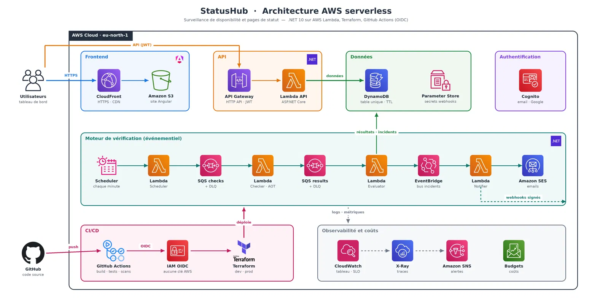

# StatusHub

**Un service de surveillance de disponibilité : vous ajoutez des URL, StatusHub les teste chaque minute, ouvre un incident en cas de panne, vous prévient par email ou webhook et publie une page de statut publique.**

[](https://github.com/ademhmercha/status-hub/actions/workflows/ci.yml)
[](https://github.com/ademhmercha/status-hub/actions/workflows/deploy.yml)

| | |
|---|---|
| Application en ligne | _lien ajouté après le premier déploiement_ |
| Page de statut publique (exemple) | _lien ajouté après le premier déploiement_ |
| Démonstration vidéo | _à ajouter_ |

## Ce que fait l'application

- **Surveiller** jusqu'à 20 URL par compte (code HTTP attendu, mot-clé dans la page, délai maximal, intervalle de 1 à 5 minutes).
- **Détecter et alerter** : un incident s'ouvre après 2 échecs consécutifs et se ferme après 2 succès ; email et webhook signé (HMAC-SHA256, protégé contre le rejeu).
- **Informer** : une page de statut publique avec l'état de chaque service, l'historique sur 90 jours et les incidents récents.
- **Analyser** : disponibilité sur 24 h / 7 j / 30 j, latence p50 et p95, liste des incidents.
- **Démontrer** : un panneau de démo coupe et rétablit une cible intégrée pour voir l'incident s'ouvrir, l'alerte partir et l'incident se fermer en direct.

<!-- Captures d'écran : à réactiver quand docs/screenshots/*.png existent (liste dans docs/screenshots/README.md)
| Tableau de bord | Détail d'un moniteur | Page de statut publique |
|---|---|---|
|  |  |  |
-->

## Architecture




Une vérification traverse quatre fonctions (Scheduler → Checker → Evaluator → Notifier) reliées par des files SQS avec file d'attente des échecs (DLQ). Chaque étape est idempotente :
un message livré deux fois ne produit qu'un seul résultat et un seul incident.

## Technologies

| Domaine | Choix |
|---|---|
| Backend | .NET 10, C#, ASP.NET Core Minimal API, AWS Lambda (le Checker en Native AOT), Powertools for AWS Lambda (le Checker, en AOT, utilise un équivalent natif : logs JSON et métriques EMF) |
| Données et messages | DynamoDB (une seule table), SQS + DLQ, EventBridge (bus et Scheduler), SES |
| Frontend | Angular (composants autonomes, signals), graphiques SVG maison, mode clair/sombre |
| Authentification | Amazon Cognito (email/mot de passe, Google en option), JWT |
| Infrastructure | Terraform (modules, environnements dev et prod), région `eu-north-1` |
| Qualité | xUnit + Testcontainers (DynamoDB Local), Vitest, k6 |

Contraintes de conception : pas de NAT, pas de VPC, pas d'EC2 ni de RDS ; moindre privilège IAM (un rôle par Lambda) ; aucun secret dans le dépôt.

## CI/CD

Chaque pull request est construite, testée (unitaires, intégration, frontend), analysée (Trivy, Checkov, tflint) et reçoit en commentaire le `terraform plan`.
Un push sur `main` construit **une seule fois** les artefacts, les déploie sur **dev**, exécute un smoke test, puis attend une **approbation manuelle** avant **prod**
(les deux environnements reçoivent exactement les mêmes fichiers). L'authentification à AWS passe par OIDC : aucune clé n'est stockée dans GitHub.
Chaque Lambda a un alias `live` : un retour arrière prend quelques secondes. Détails : [`docs/ci-cd.md`](docs/ci-cd.md).

## Observabilité et SLO

- Logs JSON avec identifiant de corrélation, métriques CloudWatch (EMF) et traces X-Ray de bout en bout, tableau de bord `statushub-<env>`.
- **SLO : 99,5 % des vérifications exécutées moins de 60 s après leur heure prévue, sur 30 jours glissants**, avec budget d'erreur et alarmes de consommation rapide et lente.
- Alarmes (file d'échecs, erreurs, limitation, 5xx) et runbook pour chacune. Détails : [`docs/slo.md`](docs/slo.md), [`docs/runbook.md`](docs/runbook.md).

## Résultats

Chiffres **mesurés en local** (500 moniteurs, 5 minutes, base DynamoDB locale), détail et méthode dans [`docs/results.md`](docs/results.md) :

| Mesure | Résultat |
|---|---|
| Moniteurs surveillés en parallèle | 500 (8,3 vérifications par seconde) |
| Vérifications perdues / en retard (> 60 s) | 0 / 0 sur 2 500 |
| Retard après l'heure prévue (p95) | 0,8 s |
| Panne → incident → alerte (intervalle 1 min) | ≈ 1 à 2 min ; alerte en 0,1 s après l'incident |
| Tests automatiques | 208 (backend 170, frontend 38), tous verts |

Les mesures sur AWS (charge de 30 minutes, démarrages à froid Native AOT contre JIT, coût réel mensuel) sont préparées ([`loadtest/`](loadtest/README.md)) et seront ajoutées après le déploiement.
Estimation des coûts et leviers d'optimisation : [`docs/costs.md`](docs/costs.md).

## Lancer en local (sans compte AWS)

Prérequis : .NET SDK 10, Node.js 20.19+ (22 conseillé), Docker.

```bash
docker compose up -d dynamodb mailhog       # DynamoDB Local :8000 et MailHog (emails) : interface http://localhost:8026
cd backend
dotnet run --project src/StatusHub.Api      # API :5080 + worker local (Scheduler → Checker → Evaluator → Notifier)
cd ../frontend
npm install
npm start                                   # http://localhost:4200
```

1. Ouvrez http://localhost:4200, saisissez un email (mode local : pas de mot de passe vérifié) puis **Inscription**.
2. Sur le tableau de bord, **Ajouter un moniteur de démo**, puis **Simuler une panne**.
3. Après 2 minutes environ, l'incident s'ouvre et l'email arrive dans MailHog ; **Rétablir** referme l'incident.

Tests : `cd backend && dotnet test` (Docker requis pour les tests d'intégration) et `cd frontend && npm test -- --watch=false`.

## Documentation

[`docs/data-model.md`](docs/data-model.md) (modèle DynamoDB) · [`docs/ci-cd.md`](docs/ci-cd.md) · [`docs/slo.md`](docs/slo.md) · [`docs/runbook.md`](docs/runbook.md) · [`docs/reliability.md`](docs/reliability.md) · [`docs/costs.md`](docs/costs.md) · [`docs/results.md`](docs/results.md) · [`infra/README.md`](infra/README.md)

## Prochaines étapes

- **Vérifications multi-régions** : tester chaque URL depuis plusieurs régions AWS et n'ouvrir un incident qu'en cas de consensus, pour éliminer les faux positifs réseau.
- **Domaine personnalisé** pour l'application et pour les pages de statut (certificat ACM, Route 53), avec un sous-domaine par client.
- Intervalle de 30 secondes, vérifications TCP/DNS/certificat TLS, notifications Slack, abonnement aux pages de statut.
- Réduction du coût d'écriture DynamoDB (état écrit uniquement sur changement, résultats échantillonnés) : voir `docs/costs.md`.

## Licence

Projet de démonstration.
